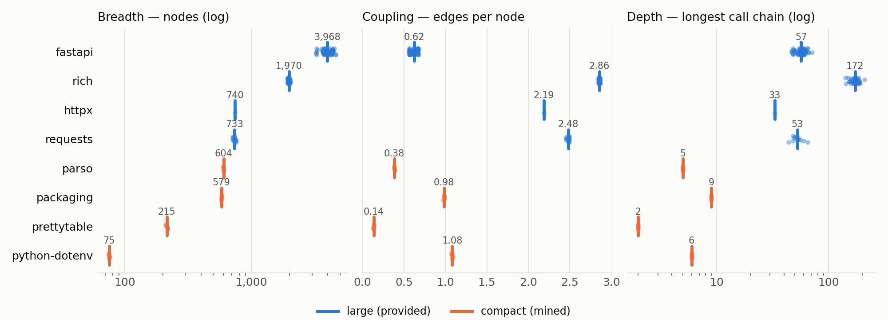

# SWE-Pocket

**A repository-size-stratified evaluation resource for consumer-hardware coding agents.**

Standard SWE benchmarks fix repository size by construction and never report it.
SWE-Pocket makes size a measured, controlled variable: 153 Python tasks across a
**large** stratum (the 129 tasks released with the
[Gemma 4 Developer Agent](https://www.kaggle.com/competitions/gemma-4-developer-agent)
competition) and a **compact** stratum (24 tasks we mined from four small
libraries), all under one schema and one measurement pipeline.

Entry for the [Gemma 4 Developer Agent Paper Track](https://www.kaggle.com/competitions/gemma-4-developer-agent-paper)
(Best New Resource). Paper: [`paper/swe-pocket.md`](paper/swe-pocket.md).
Reproduction: [public Kaggle notebook](https://www.kaggle.com/code/divinenwobodo19/swe-pocket-reproduction);
`./rebuild.sh` rebuilds every derived table from the competition data.



## Findings

1. **Repository size is three axes, not one**: *breadth* (nodes), *coupling*
   (edges per node), and *depth* (longest call chain). They rank repositories
   differently: `fastapi` is the largest but the least coupled, `rich` is half its
   size with 4.6× the density and 3× the depth, and the 75-node `python-dotenv` is
   more densely coupled than the 3,968-node `fastapi`.
2. **Structure is largely independent of fix size.** Across the 129 large tasks,
   gold-patch churn correlates with node count at r = −0.014; 71% of tasks touch a
   single source file, median fix 13 lines (r = +0.20 within the single-file
   subset, so the signal is weak but not absent).
3. **The pipeline generalises.** The same graph builder and metrics reproduce
   the axis disagreement on the mined compact repositories.

No model was run. This is a resource and a structural analysis, not a leaderboard.

## What is in this repository

| Path | Contents |
|---|---|
| `resources/compact_tasks.json` | **The 24 mined compact tasks**: problem statement, gold patch, test patch, base commit, source PR |
| `data/compact_graphs/` | Call graphs for the compact stratum (22 unique base commits), in the competition's graph schema |
| `data/*.csv`, `data/compact_joined.json` | Per-task structural and gold-patch metrics for all 153 tasks |
| `resources/test_sets.json` | FAIL_TO_PASS / PASS_TO_PASS test names extracted per large task |
| `resources/provenance.*` | Upstream commit/PR provenance for every large-stratum instance |
| `notebooks/reproduce.ipynb` | Recomputes every number in the paper from the tables above, with no GPU and no downloads |
| `scripts/` | The full construction and analysis pipeline |
| `DATASHEET.md` | Composition, collection process, limits, intended uses |

### What is *not* in this repository

The competition's `tasks.jsonl` (problem statements and patches for the 129
large tasks), code graphs, embeddings, and harness are **not redistributed**.
They remain under the competition's terms. This repository carries only task
identifiers and metrics derived from them, plus scripts that rebuild those
metrics for anyone who has joined the competition.

## Reproduce

**Paper numbers (no downloads, standard library only):**

```bash
python3 -c "import json;exec('\n'.join(''.join(c['source']) for c in json.load(open('notebooks/reproduce.ipynb'))['cells'] if c['cell_type']=='code'))"
# or open notebooks/reproduce.ipynb in Jupyter / Kaggle
python3 scripts/make_figure1.py        # Figure 1 (needs matplotlib)
```

**Rebuild the derived tables from the competition data** (requires joining
[the competition](https://www.kaggle.com/competitions/gemma-4-developer-agent) and a Kaggle API token):

```bash
./rebuild.sh
```

`rebuild.sh` downloads `tasks.jsonl` and the 127 code graphs (~400 MB), then
runs `stratify.py → extract_tests.py → merge_gold_structure.py` for the large
stratum and `stratify.py → build_compact_joined.py` for the compact stratum. We
verified that it reproduces every shipped table byte-for-byte.

**Re-mine the compact stratum from GitHub** (optional; upstream history can
change): `GH_TOKEN=$(gh auth token) python3 scripts/mine_compact.py`, then
`python3 scripts/build_compact_graphs.py`.

## Licence

- **Code** (`scripts/`, `notebooks/`, `rebuild.sh`): Apache-2.0. See [`LICENSE`](LICENSE) and [`NOTICE`](NOTICE).
- **Data and paper** (our tables, compact graphs, task records, figures, text): CC-BY-4.0. See [`LICENSE-DATA`](LICENSE-DATA).
- **Upstream code** inside the compact task patches stays under its project's own licence:
  `pypa/packaging` (Apache-2.0 or BSD-2-Clause), `jazzband/prettytable` (BSD-3-Clause),
  `davidhalter/parso` (MIT, some files PSF), `theskumar/python-dotenv` (BSD-3-Clause).
  Each task record links to its source pull request.

## Citation

```
@misc{swepocket2026,
  title  = {SWE-Pocket: A Size-Stratified Evaluation Resource for Local Coding Agents},
  author = {Nwobodo, Divine},
  year   = {2026},
  note   = {Gemma 4 Developer Agent Paper Track, Kaggle},
  url    = {https://github.com/divinenwobodo19-creator/swe-pocket}
}
```

Maintained by N-Library. Corrections and questions: open an issue.
