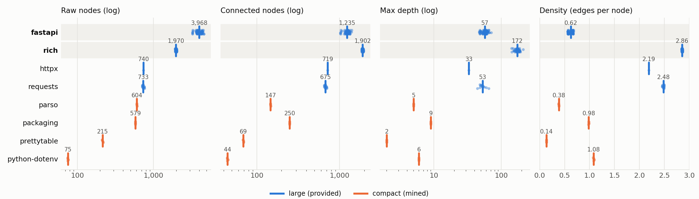

# SWE-Pocket: A Size-Stratified Evaluation Resource for Local Coding Agents

## Abstract

Coding agents are evaluated almost exclusively on large, cloud-scale benchmarks,
while the fastest-moving frontier is agents small enough to run on a developer's
own machine. Yet no standard benchmark reports repository size as a variable:
size is fixed by construction and never measured. We introduce SWE-Pocket, a
size-stratified evaluation resource for Python repositories. It combines the 129
task instances released with the competition — each with a problem statement,
gold patch, test patch, and a merged upstream pull request — with 24 tasks we
mine from four deliberately compact libraries under an identical schema.
Analysing the code graphs of all 153 tasks, we find that raw node count is
a biased measure of repository size: in `fastapi`, 69% of nodes take part in no
call edge, and counting only connected nodes reverses its rank against the
half-sized `rich`. Size is therefore two dimensions — connected scale and
coupling — not one. Neither tracks the fix a task requires: within repositories,
|r| ≤ 0.26 for nodes, edges and density, and 71% of tasks touch one file with a
median fix of 13 lines. We release our mined tasks, tooling, graphs, and metrics;
competition data are referenced, never redistributed.

---

## 1. Introduction

The Gemma 4 Developer Agent competition exists because practical coding agents
are moving toward models small enough to run on consumer hardware — laptops,
single GPUs, offline machines. Evaluation has not followed. The standard suite,
from SWE-bench to its descendants, fixes its repository set to a handful of
large, heavily depended-on projects and reports one number: resolve rate.
Repository size is not a variable; it is a constant so large that every task
inherits the same cloud-scale context cost.

This leaves a question for anyone building the agents this competition is
about. If two tasks require the same one-line edit, does it matter whether
that line lives in a 75-node library or a 4,000-node framework? Existing
benchmarks would score them identically, because none reports the structure the
agent had to navigate. The gap is not that small agents perform worse; it is
that **no benchmark makes repository size a controlled, reported axis.**

We introduce SWE-Pocket, a size-stratified evaluation resource that closes this
gap without requiring any model training or GPU to construct or analyse. Our
contributions are three:

1. **A size-stratified resource.** 153 Python tasks across two strata: 129
   provided across four large libraries, and 24 mined from four compact ones, all
   sharing one schema (problem statement, gold patch, test patch) and one
   measurement pipeline (§3).

2. **Evidence that raw node count is a biased size measure.** In the
   competition's own graphs, 69% of `fastapi`'s nodes carry no call edge;
   counting only connected nodes reverses its rank against the half-sized
   `rich`. Size is two dimensions — connected scale and coupling — and neither
   predicts the fix a task requires (§4.2–4.3).

3. **A reusable, GPU-free construction and analysis pipeline.** Every number is
   recomputed by a public notebook from released tables, and the tables are
   rebuilt from the competition data by released scripts, on a laptop CPU (§4).

We make no claim about agent accuracy. With limited time we chose a correct,
fully reproducible resource and analysis over an under-powered leaderboard.

---

## 2. Related Work

**SWE benchmarks fix their repositories.** SWE-bench [1] draws its tasks from
twelve large Python repositories and reports resolve rate; SWE-bench Verified [2]
is a human-validated subset; SWE-bench Multimodal [3] extends to visual tasks but
not to size; SWE-bench-Live [4] keeps tasks fresh but leaves scale unchanged. In
all of them repository size is a fixed property of the source projects, never an
analysis variable.

**Repo-level agent methods.** Agentless [5], AutoCodeRover [6], SWE-agent [7],
and OpenHands [8] differ in how they localise and edit, but each is evaluated on
the same fixed-size corpora, answering "which method resolves more tasks," not
"how does scale change what a method must do."

**Code-graph and retrieval methods.** RepoGraph [9], LocAgent [10], and
GraphRAG-style systems [11] exploit structure for navigation — precisely the
structure SWE-Pocket measures. They consume graphs as a tool; we treat the graph
as the object of study.

**Small and local models.** Qwen2.5-Coder [14], DeepSeek-Coder [15], and
StarCoder2 [16] are the agent class this resource is for; their agentic
evaluation also defaults to the large SWE-bench corpora.

**Benchmark critique.** A growing literature asks what SWE-bench measures:
solution leakage and weak tests [12], patches that pass without being correct
[13], memorisation [17]. Concurrent competition entries
audit its run-to-run noise.

**Gap statement.** None of this work stratifies by size or reports the structure
an agent navigated; that is the gap SWE-Pocket fills.

---

## 3. The SWE-Pocket Resource

### 3.1 The large stratum (provided)

The competition ships `tasks.jsonl`, 129 task definitions across four Python
libraries: `fastapi` (67), `rich` (48), `psf/requests` (13), and `httpx` (1).
Each row has an `instance_id`, `repo`, `base_commit`, gold `patch`, `test_patch`,
and `problem_statement`. We verified provenance for all 129 through the GitHub
API: every `instance_id` is a real, **merged** upstream pull request, and every
`base_commit` equals its base SHA. None of the 129 appear among SWE-bench's 2,294
instances, so these are not a relabelled public set.

The competition also provides, per unique base commit (127; two are shared by two
tasks each), a code graph and a 256-dimensional node embedding. Graph node text
is a stubbed signature rendering — function bodies replaced by `...` — so the
graphs are a navigation aid, not a recoverable task source.

### 3.2 The compact stratum (mined)

To make size a variable, we mined a compact stratum. `mine_compact.py` pulls
merged pull requests from four small, dependency-light libraries —
`pypa/packaging`, `jazzband/prettytable`, `davidhalter/parso`, and
`theskumar/python-dotenv` — keeping those whose diff touches at most 6 files and
4–160 lines, with both source and test changes. The result is 24 tasks, six per
repository, in the schema of the provided 129. `build_compact_graphs.py` parses
each repository at its base commit with Python's `ast` and emits a call graph in
the same schema (nodes keyed `module.symbol`, `calls` edges between uniquely
resolved symbols), so both strata run identical measurement code.

The strata are cleanly separated on both counts: compact repositories span 75–606
raw nodes (44–250 connected), the large stratum 711–4,597 raw (654–1,952
connected). That separation is what lets us treat size as a controlled axis.

Every compact task was replayed end to end: all 24 patch pairs apply cleanly, and
21 fail before the gold patch and pass after. The three exceptions (all `parso`)
are version-gating test changes that already pass at base; they are retained for
provenance and flagged `discriminates: false` in the release.

### 3.3 Measurement

For every task we compute, from its code graph alone: node count, connected node
count (nodes with at least one incoming or outgoing call edge), edge count, file
count, density (edges per node), isolated share, maximum fan-in, and `max_depth`,
the longest acyclic call chain (cycle-safe iterative traversal, since naive
recursion does not scale to multi-thousand-node graphs).
From the task definition we compute two independent signals: gold-patch churn
(added + deleted lines) as a proxy for fix size, and the FAIL_TO_PASS test count
recovered from `test_patch`. In the large stratum, 106 of 129 tasks expose at
least one FAIL_TO_PASS test; in total we recover 464 FAIL_TO_PASS and 124
PASS_TO_PASS test functions.

---

## 4. Structural Analysis

### 4.1 Setup

We analyse all 153 tasks. The large stratum is a census of the competition's 129.
The 24 compact tasks are a filtered subset of upstream pull requests, not a
random sample, so compact numbers are descriptive. Repository summaries are means
(churn: median). Correlations use the 129 large tasks and are reported per
repository as well as pooled, because tasks cluster within repositories.

### 4.2 Result 1 — raw node count is a biased size measure

Table 1 and Figure 1 compare the count a benchmark would naturally report — nodes
in the code graph — with the count an agent can actually traverse.

**Table 1. Repository structure by stratum (means; churn is median lines;
connected = mean per-task connected nodes).**

| repo | stratum | n | raw nodes | isolated % | connected | edges | density | max depth | gold churn |
|---|---|---|---|---|---|---|---|---|---|
| `fastapi` | large | 67 | 3,968 | 68.7 | 1,235 | 2,458 | 0.62 | 57 | 19 |
| `rich` | large | 48 | 1,970 | 3.5 | 1,902 | 5,626 | 2.86 | 172 | 10 |
| `requests` | large | 13 | 733 | 7.9 | 675 | 1,819 | 2.48 | 53 | 5 |
| `httpx` | large | 1 | 740 | 2.8 | 719 | 1,618 | 2.19 | 33 | 86 |
| `packaging` | compact | 6 | 579 | 56.8 | 250 | 569 | 0.98 | 9 | 12 |
| `parso` | compact | 6 | 604 | 75.7 | 147 | 232 | 0.38 | 5 | 6 |
| `prettytable` | compact | 6 | 215 | 68.0 | 69 | 29 | 0.14 | 2 | 12 |
| `python-dotenv` | compact | 6 | 75 | 41.1 | 44 | 82 | 1.08 | 6 | 19 |

**Figure 1.** Rows ordered by raw node count: (a) raw, (b) connected, (c) depth,
(d) density. If raw count measured navigable size every panel would share (a)'s
order; connected nodes and depth reverse the top two rows, density follows
neither.

Provided graphs contain a node for every function and method, including those
that neither call nor are called by anything else. In `fastapi` these dominate:
69% of nodes have no call edge, as expected of a framework whose handlers are
invoked by a router. `rich` is 3% isolated. Counting only connected nodes
reverses the top of the ranking: `rich` has 1,902 navigable nodes to `fastapi`'s
1,235, despite half the raw count. The `fastapi`–`rich` comparison is within the
large stratum, where one builder produced every graph.

**Bias.** Stratifying on raw count would put `fastapi` in the largest bucket and
`rich` in the next — the reverse of the navigable order. On raw count `fastapi`
leads by 2.0×; on connected nodes it trails by 1.5×. The error is systematic,
plausibly tracking how much of a library is entry points and data classes rather
than internal calls.

**Scale is one dimension.** Connected nodes and depth rank the eight repositories
almost identically (ρ = +0.90, n = 8, both strata, descriptive), and `rich` is
both the largest navigable repository and the deepest (172 frames against 57 for
`fastapi`). Depth tracks connected scale.

**Coupling is the second.** Density is only partly explained by scale: connected
nodes and density rank-agree at ρ = +0.55 across the eight repository means.
`requests` has half of `fastapi`'s connected nodes (675 against 1,235) at four
times the density (2.48 against 0.62); `python-dotenv`, the smallest repository at
44 connected nodes, is denser than `fastapi` (1.08 against 0.62).

**The finding:** size is two dimensions, not one and not three. Connected scale
is what a benchmark should stratify on, because raw count misranks it; coupling
must be reported separately, because it varies independently of scale and at the
low end inverts it.

### 4.3 Result 2 — structure does not predict fix size

If the dimensions tracked fix size they would be redundant; they do not.

**Table 2. Pearson correlation with gold-patch churn, per repository.**

| axis | pooled (n = 129) | `fastapi` (67) | `rich` (48) | `requests` (13) |
|---|---|---|---|---|
| nodes | −0.014 | +0.23 | +0.08 | +0.25 |
| edges | +0.088 | +0.11 | +0.08 | +0.24 |
| density | +0.055 | −0.17 | +0.12 | +0.12 |
| max depth | +0.102 | −0.03 | +0.16 | +0.65 |

The pooled node correlation is −0.014, but tasks cluster in four repositories and
the sign is positive within each: a composition effect, not independence. A
repository-clustered bootstrap gives [−0.05, +0.22]; with four clusters the
interval is coarse, and its message is that the pooled sign is unidentified.
We therefore read Table 2 by column.

Read that way the result is narrow: |r| ≤ 0.26 for nodes, edges and density in
every repository; the exception is depth in `requests` (r = +0.65, n = 13,
unstable). No axis explains more than 7% of churn variance elsewhere. Structure
carries a weak signal about fix size, not none.

The typical task is small: **91 of 129 tasks (71%) touch one source file**, and
the median fix is **13 changed lines** (7 in the single-file subset). Fix size
varies far less than scale, which spans 75–4,597 raw and 44–1,902 connected
nodes: a benchmark can hold fixes roughly constant while scale varies by an order
of magnitude. No existing benchmark exploits this.

### 4.4 Result 3 — the pipeline generalises

The identical pipeline on the 24 compact tasks produces graphs and metrics in
the same schema, with no repository-specific tuning (Table 1, lower
block; Figure 1, orange). The compact repositories show the same within-stratum
pattern: raw counts overstate navigable structure (`parso`: 604 raw, 147
connected, 76% isolated) and density varies independently of scale. Cross-stratum
edge comparisons carry the builder caveat in §4.5; the construction claim does
not depend on them. SWE-Pocket is a *construction*, not a one-off analysis: the
same schema, builder, and metrics extend to any repository.

### 4.5 Threats to validity

We make claims about structure, not agents. (i) Structural metrics are a *proxy*
for navigation cost; we did not measure agent behaviour. (ii) Compact graphs come
from our `ast` builder, provided graphs from the organisers'; they resolve calls
differently, so cross-stratum comparisons carry this caveat. The §4.2 comparison
is within one stratum and unaffected. (iii) The isolated share is
builder-dependent, but both builders produce high shares (69% `fastapi`, 76%
`parso`), so the phenomenon is not one implementation's artefact. (iv) The
resource is Python-only, and the compact stratum is small (24 tasks, 21
discriminating), so its statistics are descriptive. (v) Churn proxies fix *size*,
not *difficulty*. (vi) `httpx` (one task) is excluded from correlations;
`requests` (13) yields unstable estimates. (vii) We report no model baselines
(§5).

---

## 5. Discussion and Limitations

**What reporting two dimensions buys.** A resource like this can pose
questions a resolve-rate number cannot. Does a fixed one-line edit get harder as
coupling rises, independent of connected scale? And which dimension predicts
where a small-context agent loses the thread? Both are cheap to test once
structure is reported; we release the resource that makes them askable.

**What we do not claim.** We report no agent accuracy and no failure taxonomy.
An earlier plan included both; with a fixed time budget we cut them rather than
ship an under-powered leaderboard.

**Honesty about the statistics.** Result 2 is the paper's most quotable and most
fragile. Pooled over 129 tasks the node–churn correlation is −0.014, but the
tasks are not independent and within each repository the sign is positive. We
report the pooled value, the per-repository values, the clustered interval, and
the single-file subset. The defensible claim is narrow: fix size is small and
varies far less than repository scale.

**Reproduction cost.** Every result builds and analyses on a CPU with no model
run — deliberately, since the resource is for people whose budgets are small. The
pipeline itself demonstrates the competition's premise.

**Responsible release.** Competition tasks, graphs, and embeddings are never
redistributed; we release task identifiers and derived metrics, plus scripts that
rebuild them for anyone with competition access. Our mined tasks, graphs, and
tooling are released openly with provenance to each upstream pull request.

---

## 6. Conclusion

We introduced SWE-Pocket, a size-stratified evaluation resource for
consumer-hardware coding agents. It contributes (1) 153 Python tasks across two
strata — 129 provided and 24 mined — under one schema and pipeline; (2) evidence
that raw node count is a biased size measure, that connected nodes reverse the
ranking of the two largest repositories, and that size is two dimensions —
connected scale and coupling — neither of which predicts the fix a task
requires; and (3) a GPU-free pipeline that generalises from provided
repositories to mined ones. We release everything needed to report size honestly in future benchmarks
and agents.

**Code and data:** https://github.com/divinenwobodo19-creator/swe-pocket (code Apache-2.0, data CC-BY-4.0).
**Public notebook:** https://www.kaggle.com/code/divinenwobodo19/swe-pocket-reproduction

---

## References

[1] C. E. Jimenez et al. SWE-bench: Can Language Models Resolve Real-World GitHub Issues? ICLR 2024. arXiv:2310.06770.
[2] OpenAI. Introducing SWE-bench Verified. 2024.
[3] J. Yang et al. SWE-bench Multimodal: Do AI Systems Generalize to Visual Software Domains? 2024. arXiv:2410.03859.
[4] L. Zhang et al. SWE-bench Goes Live! 2025. arXiv:2505.23419.
[5] C. S. Xia et al. Agentless: Demystifying LLM-based Software Engineering Agents. 2024. arXiv:2407.01489.
[6] Y. Zhang et al. AutoCodeRover: Autonomous Program Improvement. ISSTA 2024. arXiv:2404.05427.
[7] J. Yang et al. SWE-agent: Agent-Computer Interfaces Enable Automated Software Engineering. NeurIPS 2024. arXiv:2405.15793.
[8] X. Wang et al. OpenHands: An Open Platform for AI Software Developers as Generalist Agents. 2024. arXiv:2407.16741.
[9] S. Ouyang et al. RepoGraph: Enhancing AI Software Engineering with Repository-level Code Graph. 2024. arXiv:2410.14684.
[10] Z. Chen et al. LocAgent: Graph-Guided LLM Agents for Code Localization. 2025. arXiv:2503.09089.
[11] D. Edge et al. From Local to Global: A Graph RAG Approach to Query-Focused Summarization. 2024. arXiv:2404.16130.
[12] R. Aleithan et al. SWE-Bench+: Enhanced Coding Benchmark for LLMs. 2024. arXiv:2410.06992.
[13] Y. Wang et al. Are "Solved Issues" in SWE-bench Really Solved Correctly? An Empirical Study. 2025. arXiv:2503.15223.
[14] B. Hui et al. Qwen2.5-Coder Technical Report. 2024. arXiv:2409.12186.
[15] D. Guo et al. DeepSeek-Coder: When the Large Language Model Meets Programming. 2024. arXiv:2401.14196.
[16] A. Lozhkov et al. StarCoder 2 and The Stack v2: The Next Generation. 2024. arXiv:2402.19173.
[17] S. Liang et al. The SWE-Bench Illusion: When State-of-the-Art LLMs Remember Instead of Reason. 2025. arXiv:2506.12286.
